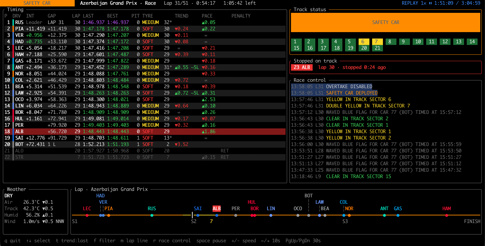

# pitwall



`pitwall` is an F1 data feed for nerds made in the style of `htop`.
Featuring both live mode and replays, take the role of a pitwall crew member
and monitor detailed data and stats during sessions.

## Install

```sh
brew install jmvezic/tap/pitwall
```

## Setup

Fetching live F1 timing data requires a subscription to F1TV. If you already have it, just login and you can start using pitwall:
```sh
pitwall login
```

## Run

### Live sessions

You can track all live sessions - practice, sprint quali, sprint, quali and race.
Live data for sessions usually start an hour to minutes before the session itself.
`pitwall` will automatically detect live data and refresh on its own.

```sh
pitwall
```

### Replay previous sessions

You can also replay all previous sessions as well, if you want to.
Browse the archive by running `pitwall replay [year]`, e.g.:

```sh
pitwall replay 2026
```

or if you already know what you want to replay:

```sh
pitwall replay 2025 singapore quali
```

## Usage

```sh
pitwall                                  # follow the live session
pitwall live --record                    # ...and record it for later replay
pitwall replay                           # browse this season's sessions
pitwall replay 2025                      # browse 2025
pitwall replay 2025 singapore            # choose a Singapore session
pitwall replay 2025 singapore race       # replay from the archive
pitwall replay 2025 monza quali --speed 8 --start 00:30:00
pitwall replay --dir ~/path/to/recording # replay a recording
pitwall replay 2025 spa race --dump      # print the messages instead of the UI
pitwall list 2025                        # meetings and sessions
pitwall record --out DIR                 # record without the UI
```

Sessions: `race`, `quali`, `sprint`, `sq` (sprint qualifying), `fp1`–`fp3`, or any
part of the session name. Meetings match on name, location or country.
Leave out the session (or the meeting too) to pick from a list: arrow keys,
Enter to open or replay, Esc to go back. Replays start one minute before the
session starts unless you pass `--start`.

`--no-map` skips the large `Position.z` / `CarData.z` downloads; the lap line
then places cars by timing mini-sector.

### Keys

| Key | Action |
| --- | --- |
| `q` | quit |
| `↑` / `↓` | select a driver (highlighted on the lap line) |
| `Esc` | clear selection / back to the main view |
| `t` | trend and pace: average of last 3 laps ↔ last lap only |
| `f` | hide DRS and blue-flag race control messages |
| `m` | show / hide the lap line and weather |
| `r` | race control full screen |
| `x` | reset: clear everything and reconnect for a fresh snapshot (live) |
| `s` | sync the delay: press at lights out on the video (live) |
| `v` | sync the delay: type the race time, or in qualifying and practice the time left, shown on the video (live) |
| `+` / `-` | delay +/− 1 s (live) |
| `space` | pause (replay) |
| `+` / `-` | speed 1×–60× (replay) |
| `←` / `→` | seek 10 s (replay) |
| `PgUp` / `PgDn` | seek 30 s (replay) |

## F1 TV token

Live car positions and telemetry (`Position.z`, `CarData.z`) need an F1 TV
subscription. Without a token the live view still works: the lap line places
cars by the timing mini-sector they last passed (about 20–25 steps per lap
instead of smooth movement), and stopped cars are detected from timing alone.

Replays need the token too.

```sh
pitwall login
```

It reads only the `login-session` cookie for `formula1.com` and takes the
token from it. The token is never printed.

## Credits

Circuit outlines and sector positions come from
[MultiViewer](https://multiviewer.app)'s API, and the championship's rounds
and wins from [Jolpica](https://github.com/jolpica/jolpica-f1). Thanks to
both. Jolpica's data is licensed
[CC BY-NC-SA 4.0](https://creativecommons.org/licenses/by-nc-sa/4.0/) and
is free for non-commercial use only.

## Disclaimer

pitwall is unofficial and is not associated in any way with the Formula 1
companies. F1, FORMULA ONE, FORMULA 1, FIA FORMULA ONE WORLD CHAMPIONSHIP,
GRAND PRIX and related marks are trademarks of Formula One Licensing B.V.

Data from F1's live timing service is F1's, for personal, non-commercial
use under F1's terms. Using an F1 TV token with pitwall is subject to your
F1 TV subscription terms.

## License

[MIT](LICENSE)
